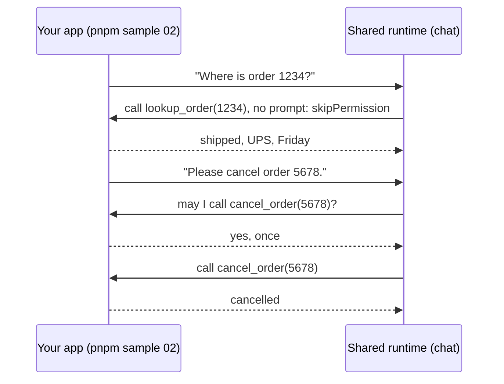

# 02 · Give it your own tools

Give a chat agent two tools that run in your own process: one it may call freely, and one that needs your approval
first.

**You need:** the platform running (`aspire run`). **Concepts:** [the harness](../../docs/concepts/harness.md).



## Run it

```powershell
pnpm sample 02
```

## What you'll see

```text
You: Where is order 1234?

  [your app, pid 46832] lookup_order 1234
Order **1234** is **shipped** via UPS, expected to arrive **Friday**. 📦

You: Please cancel order 5678.

  [your app, pid 46832] lookup_order 5678
Order 5678 is still "processing" (not yet shipped), so it's eligible for cancellation.
  [your app] approve cancel_order {"id":"5678"}? yes

  [your app, pid 46832] cancel_order 5678
Done — order **5678** is now **cancelled**. ✅
```

## What happened

1. Both tools are ordinary `defineTool` tools. Their handlers ran in this process (`pid 46832`), with this process's
   data. The agent saw only what they returned.
2. `lookup_order` has `skipPermission: true`, so the agent called it straight away.
3. `cancel_order` has a side effect and no `skipPermission`, so the runtime asked `onPermissionRequest` first. The
   handler printed the request and approved it once.
4. The agent decided on its own to look the order up before cancelling it. The reply streamed in as
   `assistant.message_delta` events.

## The code

```ts
const lookupOrder = defineTool("lookup_order", {
  description: "Look up an order by its id",
  parameters: z.object({ id: z.string() }),
  skipPermission: true,                        // read-only: no approval prompt
  handler: async ({ id }) => orders[id] ?? { error: `No order ${id}` },
});

const session = await client.createSession({
  model: "claude-sonnet-5",
  tools: [lookupOrder, cancelOrder],
  streaming: true,
  onPermissionRequest: (request, invocation) => {
    if (request.kind === "custom-tool") console.log(`approve ${request.toolName} ${JSON.stringify(request.args)}? yes`);
    return approveAll(request, invocation);
  },
});
session.on("assistant.message_delta", (event) => process.stdout.write(event.data.deltaContent));
```

Full script: [`main.ts`](main.ts).

## Try next

- Return `{ kind: "reject", feedback: "Cancellations need a manager's sign-off." }` for `cancel_order` instead. The
  handler never runs, and the agent answers with your feedback in mind.
- Your app must be running to answer its tools. To answer them while it's away, see
  [08 · Keep working while your app is offline](../08-offline/README.md).
- Next walkthrough: [03 · A coding agent in a sandbox](../03-sandbox/README.md).
