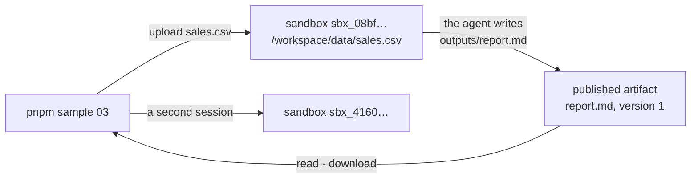

# 03 · A coding agent in a sandbox

Give an agent its own Linux sandbox, upload a CSV, and get a report back as a published artifact. Then watch a second
session from the same client get a second sandbox.

**You need:** the platform running with Docker (`aspire run`). **Concepts:**
[environments](../../docs/concepts/environments.md), [sandboxes](../../docs/concepts/sandboxes.md).



## Run it

```powershell
pnpm sample 03
```

## What you'll see

````text
Creating a session. Its sandbox is ready before createSession returns...
Session 28b921af-20fa-4011-b370-0c4db809a9d8 runs in sandbox sbx_08bf3d62ad267a2d3e729de7 (medium)

Inside the sandbox:
```
Linux aarch64
agent
/workspace
sales.csv
```

Published outputs/report.md (version 1, 278 bytes)

# Sales Report

## Total Revenue per Region

| Region | Total Revenue |
|--------|---------------|
| North  | 60750         |
| South  | 46950         |

## Best Month

The best month by total revenue is **2026-09**, with combined revenue of 40200 (North: 22650, South: 17550).

Downloaded to samples/.output/report.md

A second session from the same client runs in sandbox sbx_4160d0800d40a03608205b5e
````

The whole run took 24 seconds locally, both sandboxes included.

## What happened

1. `coder` is an `isolated` environment, so `createSession` made a new sandbox and returned only once it was ready.
2. `files(session).upload()` streamed `sales.csv` into the sandbox's `/workspace`.
3. The agent ran real commands in the sandbox: Linux, as the unprivileged user `agent`, in `/workspace`. On an ARM64
   laptop, Docker runs it as `aarch64`. On Azure it's `x86_64` ([walkthrough 10](../10-azure/README.md)).
4. When the turn completed, the platform published everything under `/workspace/outputs`.
   `waitForPublication()` waited for exactly that, then `read()` and `download()` fetched the report.
5. The second `createSession` on the same client got a different sandbox. A client picks a template; it never shares
   a sandbox between sessions.
6. Deleting the sessions deleted their sandboxes and files.

## The code

```ts
const client = await managed.client("coder");
const session = await client.createSession({ model: "claude-sonnet-5", onPermissionRequest: approveAll });

await managed.files(session).upload(join(here, "sales.csv"), "data/sales.csv");
await session.sendAndWait({ prompt: "Read data/sales.csv. Write outputs/report.md with total revenue per region ..." }, 10 * 60_000);

const artifacts = managed.artifacts(session);
const publication = await artifacts.waitForPublication(); // this turn's outputs, not just "idle"
console.log(await artifacts.read("report.md"));
await artifacts.download("report.md", join(here, "..", ".output", "report.md"));
```

Full script: [`main.ts`](main.ts).

## Try next

- `const info = await managed.sessions.get(session.sessionId)` shows `info.sandbox`: its ID, size, and state.
- Leave a sandbox idle for 15 minutes and it stops; the next call starts it again with its files intact
  ([lifecycle](../../docs/concepts/sandboxes.md)).
- Next walkthrough: [04 · Start cheap, move when needed](../04-promotion/README.md).
