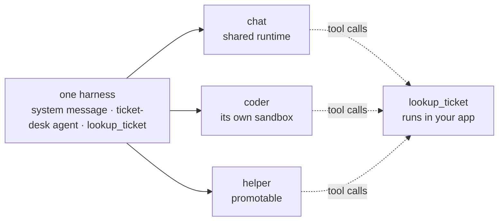
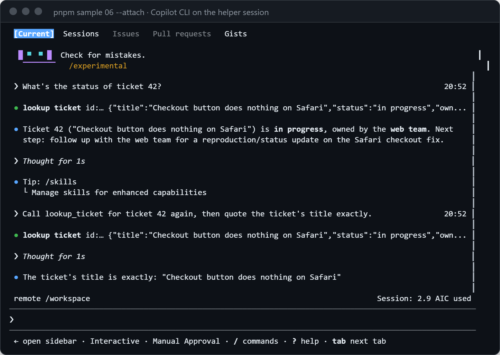

# 06 · Bring your own harness

Define a harness once in code (a system message, a custom agent, and a tool) and run it in three environments: the
shared runtime, a sandbox, and a promotable session. Then open one in Copilot CLI and watch your app's tool keep
answering.

**You need:** the platform running with Docker (`aspire run`), and [Copilot CLI](https://docs.github.com/copilot/how-tos/copilot-cli)
for `--attach`. **Concepts:** [the harness](../../docs/concepts/harness.md), [Copilot CLI](../../docs/concepts/copilot-cli.md).



## Run it

```powershell
pnpm sample 06            # the three environments
pnpm sample 06 --attach   # then open the last session in Copilot CLI
```

## What you'll see

```text
chat: shared, agent ticket-desk
  [your app, pid 36668] lookup_ticket 42
  Copilot: Ticket 42 ("Checkout button does nothing on Safari") is **in progress**, owned by the **web team**. Next step: follow up with the web team for a reproduction/fix update.

coder: sandbox (sbx_8bc20a2710a31ac3406f58ad), agent ticket-desk
  [your app, pid 36668] lookup_ticket 42
  Copilot: Ticket 42 ("Checkout button does nothing on Safari") is **in progress**, owned by the **web team**. Next step: follow up with the web team for a reproduction/fix update.

helper: shared, agent ticket-desk
  [your app, pid 36668] lookup_ticket 42
  Copilot: Ticket 42 ("Checkout button does nothing on Safari") is **in progress**, owned by the **web team**. Next step: follow up with the web team for a reproduction/status update on the Safari checkout fix.

Ask Copilot CLI about ticket 42, then type /exit to come back.
```

With `--attach`, Copilot CLI opens on the `helper` session. It shows the turn your script ran, and a new request in the
CLI calls `lookup_ticket` in your app again:

<p align="center">
  
</p>

After `/exit`, the script reports what ran while the CLI was open:

```text
While Copilot CLI was attached, lookup_ticket ran 1 time here, in pid 36668.
```

## What happened

1. The harness is a plain object of SDK session options. The same object created a session in each environment.
2. Every session used the `ticket-desk` agent and its instructions, wherever it ran, and every `lookup_ticket` call
   ran in this process (`pid 36668`).
3. `managed.openCli(session)` opened Copilot CLI on the live session. The CLI's turns used the same agent and tools,
   and the script kept answering `lookup_ticket` because it was still running.
4. The script logs quietly while the CLI owns the terminal, then prints the count.

## The code

```ts
const harness = {
  model: "claude-sonnet-5",
  systemMessage: { content: "You work on Contoso's support desk. Answer in at most two sentences." },
  customAgents: [{
    name: "ticket-desk",
    description: "Answers questions about Contoso support tickets",
    prompt: "Look up the ticket first. Give its status and owner, then one next step.",
    tools: ["lookup_ticket"],
  }],
  agent: "ticket-desk",
  tools: [lookupTicket],          // skipPermission: true, so no approval prompts
  onPermissionRequest: approveAll,
} satisfies Omit<ManagedSessionConfig, "environment">;

for (const environment of ["chat", "coder", "helper"]) {
  const session = await managed.createSession({ environment, ...harness });
  await session.sendAndWait({ prompt: "What's the status of ticket 42?" });
}

await managed.openCli(session); // --attach: Copilot CLI in this terminal; resolves when you /exit
```

Full script: [`main.ts`](main.ts).

## Try next

- Ship the same agent with the environment instead: put `ticket-desk.agent.md` in the environment's `customizations`
  folder ([the harness](../../docs/concepts/harness.md#deploy-time-ship-it-with-the-environment)).
- `npx managed-copilot new chat` opens a session with the environment's defaults only; to use a code harness in the
  CLI, create the session in code first, as this sample does.
- Next walkthrough: [07 · Network rules and secrets](../07-network-and-secrets/README.md).
