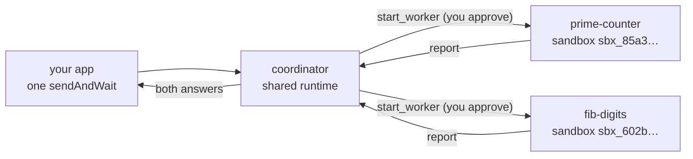

# 11 · Split a job across workers

Give an orchestrator a job with independent parts. Its coordinator starts a worker for each part, each worker runs in
its own sandbox, and the coordinator waits for their reports and answers, all inside one `sendAndWait` call.

**You need:** the platform running with Docker (`aspire run`). **Concepts:**
[orchestrator](../../docs/concepts/orchestrator.md).



## Run it

```powershell
pnpm sample 11
```

## What you'll see

```text
  [your app] approve start_worker? yes
  [your app] approve start_worker? yes
  [platform] worker.started: fib-digits in coder
  [platform] worker.started: prime-counter in coder
  [platform] worker.idle: prime-counter finished
  [platform] worker.idle: fib-digits finished

Copilot: **Primes below 100,000:** 9,592

**1,000th Fibonacci number's digit count:** 209 (using F(0)=0, F(1)=1 indexing)

Workers:
  fib-digits: idle in sandbox sbx_602bb4c8e903579637626276, worker of e4c5eaf6-1458-4408-88ec-ed90438344a4
  prime-counter: idle in sandbox sbx_85a3985c47ea3c807c7aa0a7, worker of e4c5eaf6-1458-4408-88ec-ed90438344a4
```

## What happened

1. `team` is an `orchestrator` environment, so the session is a coordinator on the shared runtime. It has no shell
   or files of its own; it has tools to start, message, wait for, and stop workers.
2. The coordinator split the job and called `start_worker` twice. Each call came to your `onPermissionRequest`, like
   any tool, and you approved it.
3. The platform started each worker as a session of `coder` (the environment's `workers`), each in a new sandbox,
   and sent it its task. `managed.on("worker.started")` fired for each one.
4. The coordinator called `wait_for_workers`. It waited without polling or model calls while the workers ran Python
   in their sandboxes. Their shell prompts were answered by the platform, within the approval you gave at
   `start_worker`.
5. When both finished (`worker.idle`), the coordinator got their reports and answered. Your `sendAndWait` returned
   once, after all of that.
6. Each worker is a session of its own: `managed.workers(session)` lists them, and `parentSessionId` points back at
   the coordinator. Deleting the coordinator deleted both workers and their sandboxes.

## The code

```ts
managed.on("worker.started", (event) => console.log(`worker.started: ${event.data.name} in ${event.data.environment}`));

const client = await managed.client("team");
const session = await client.createSession({ model: "claude-sonnet-5", onPermissionRequest: approveAll });

// One call covers the whole job. Sandboxes start inside it, so give it more than the SDK's 60-second default.
const reply = await session.sendAndWait({ prompt: "In parallel, use one worker to count the prime numbers below 100,000 with Python and another to find how many digits the 1,000th Fibonacci number has, also with Python. Then report both answers." }, 20 * 60_000);

for (const worker of await managed.workers(session).list()) console.log(worker.name, worker.state, worker.result);
```

Full script: [`main.ts`](main.ts).

## Try next

- Watch a worker work: `npx managed-copilot workers <session>` lists them, and `npx managed-copilot attach <worker>`
  opens one in Copilot CLI.
- Read a worker's files from code: `managed.files(worker.id)` and `managed.artifacts(worker.id)`.
- Hand work between workers: ask the coordinator to have one worker build something, copy its files to a reviewer
  (`copy_worker_files`), and report the review.
