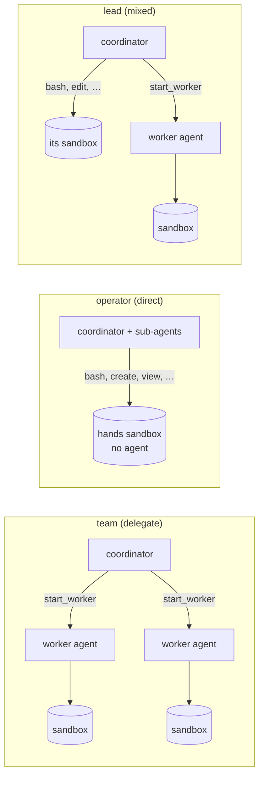

# 12 · Direct execution

The twin of [walkthrough 11](../11-orchestrator/README.md). The same job runs twice: once on `team`, a coordinator
that **delegates** to worker agents in their own sandboxes, and once on `operator`, a coordinator that works
**directly**: it and its stock sub-agents run commands and edit files in a sandbox themselves, with no agent inside it.
Then `lead`, a **mixed** coordinator that can do either, gets a job with a slow test suite and a quick fix, and the
script prints which parts the model chose to do itself and which it gave to a worker.

**You need:** the platform running with Docker (`aspire run`). **Concepts:**
[orchestrator](../../docs/concepts/orchestrator.md).



## Run it

```powershell
pnpm sample 12
```

## What you'll see

```text


== Delegate: team ==
  root agent                             start_worker     primes-counter
  root agent                             start_worker     fib-digits
  root agent                             wait_for_workers 

Copilot (team): Both tasks complete:

- **Primes below 100,000:** 9,592
- **Digits in the 1,000th Fibonacci number:** 209

  worker "primes-counter" (coder, its own agent and model loop): idle; task: Write and run a Python script that counts the number of prime numbers strictly b
  worker "fib-digits" (coder, its own agent and model loop): idle; task: Write and run a Python script that computes the 1,000th Fibonacci number (using 

== Direct: operator ==
  sub-agent 573b4e0b (task)              bash             python -c "a,b=0,1\nfor _ in range(1000): a,b=b,a+b\nprint(len(str(a))
  sub-agent d1a63fbf (task)              bash             python -c "n=100000; s=bytearray(b'\x01')*n; s[0:2]=b'\x00\x00'; impor
  sub-agent 573b4e0b (task)              bash             python -c "a,b=0,1; [None for _ in range(1000) if not (a:=b) and False
  sub-agent 573b4e0b (task)              bash             python -c "exec('a,b=0,1\\nfor _ in range(1000): a,b=b,a+b\\nprint(len

Copilot (operator): There are **9,592** primes below 100,000, and the 1,000th Fibonacci number (F(1)=1, F(2)=1) has **209 digits**.

  hands sandbox "hands" (coder, no agent in it): 4 commands, 3 by sub-agent 573b4e0b, 1 by sub-agent d1a63fbf

            sandboxes  model loops  wall time
  Delegate          2            3       12 s
  Direct            1            3       17 s

== Mixed: lead ==
  root agent                             bash             cat << 'EOF' > /workspace/collatz.py def collatz_len(n, cache): orig =
  root agent                             create           /workspace/outputs/greet.py
  root agent                             bash             cd /workspace && python3 collatz.py > collatz_result.txt 2>&1
  root agent                             bash             python3 /workspace/outputs/greet.py
  root agent                             read_bash        ex_56b29d4b49fa72240dd68f7d39b706ae
  root agent                             bash             cat /workspace/collatz_result.txt

Copilot (lead): **Collatz suite completed:** the longest Collatz chain for starting numbers below 20,000,000 begins at **15,733,191**, with a chain length of **705** steps.

Summary:
1. Slow Collatz suite: ran to completion → starting number **15733191** has the longest chain (**705** steps).
2. Quick fix: `/workspace/outputs/greet.py` fixed to `print('Hello, world!')`; output confirmed as `Hello, world!`.

Did itself: 6 tool calls in its own sandbox (bash, create, read_bash)
Gave to workers: nothing
  hands sandbox "hands" (coder, no agent in it): 4 commands, 4 by root agent
Wall time: 35 s
```

## What happened

1. **Delegate.** `team` coordinated two workers. Each worker is a whole agent (its own runtime and model loop) in its
   own sandbox; the coordinator never ran a command itself, and only saw their reports.
2. **Direct.** `operator` is the same kind of coordinator with `execution: "direct"`. Its shell and file tools
   (`bash`, `view`, `create`, `edit`, …) are the built-in names and shapes, run by the platform in a sandbox of
   `coder`. Its two `task` sub-agents used those tools too, in the same sandbox (`subagents: "shared"`, the default).
   Every agent ran in the shared runtime; the sandbox ran only their commands. Each tool call that acts (`bash`,
   `create`, `edit`, `write_bash`) came to your `onPermissionRequest`.
3. **Which agent ran which command.** The session's own `tool.execution_start` events carry `agentId` for a sub-agent's
   call, and the platform records every command with its caller (`managed.exec.list(sandbox)`), so the script prints
   both.
4. **Mixed.** `lead` has `execution: "mixed"`: the platform tells the model about its own sandbox and its worker
   environments, without rules for when to use which. The script prints what it chose. In the run above it did both
   parts itself, saving the fix and running the slow suite as a command it checked on with `read_bash`; other runs may
   hand the suite to a worker. Either way, its `bash` calls ran in its own `coder` sandbox.
5. **Cleanup.** Hands sandboxes are listed with the workers (`role: "hands"`) and go with the coordinator: deleting the
   sessions deleted every sandbox.

## The code

```ts
// apphost.mts
operator: { type: "orchestrator", workers: ["coder"], execution: "direct" },
lead: { type: "orchestrator", workers: ["coder"], execution: "mixed", maxWorkers: 3 },
```

```ts
const client = await managed.client("operator");
const session = await client.createSession({ model: "claude-sonnet-5", onPermissionRequest: approveAll });
session.on("tool.execution_start", (e) => console.log(`${e.agentId ?? "root"} → ${e.data.toolName}`));
await session.sendAndWait({ prompt: "Count the primes below 100,000 and the digits of the 1,000th Fibonacci number, in parallel, with Python." }, 20 * 60_000);

const [hands] = (await managed.workers(session).list()).filter((w) => w.role === "hands");
for (const command of await managed.exec.list(hands.id)) console.log(command.caller?.agentId ?? "root", command.command);
```

Full script: [`main.ts`](main.ts).

## Try next

- Give each sub-agent its own sandbox: `subagents: "own"`. When a sub-agent finishes, the files it saved in
  `/workspace/outputs` are copied into the coordinator's sandbox under `outputs/<agent>/`.
- Read the hands sandbox like any other: `managed.files(hands.id).list()` and `managed.artifacts(hands.id)`.
- Attach Copilot CLI to the coordinator (`npx managed-copilot attach <session>`): its `bash` calls show as
  `$ Shell <command>` and run in the sandbox (the footer reads `remote /workspace`), and each one asks in a dialog
  titled `bash` with its arguments, **1. Approve once** / **2. Deny**.
