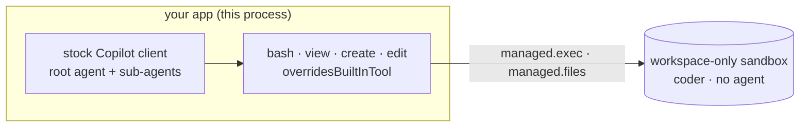

# 13 · Your own harness

Your app already runs the agent loop: its own planning, its own sub-agents. It wants their hands somewhere isolated, not
on your servers. Create a sandbox with no agent in it, run commands in it from your code, and give a stock Copilot
client tools that act there instead of on your machine.

**You need:** the platform running with Docker (`aspire run`) and a Copilot sign-in on this machine (the harness's
Copilot client runs here). **Concepts:** [sandboxes](../../docs/concepts/sandboxes.md#run-commands-directly).



## Run it

```powershell
pnpm sample 13
```

## What you'll see

```text
Sandbox 34c60b1f-3538-487c-985c-e1fdec27fff0: workspace, running (medium)

exec: exit 0, output "42\n"

background ex_0fe5b95915b1dfd1cde7a103:
  step 1
  step 2
  step 3
  -> completed, exit 0

harness:
  [brain] sub-agent started: fib-digit-counter
  [brain] sub-agent started: primes-counter
  [your app] approve create? yes
  [hands] sub-agent 3dee6319 create /workspace/fib.py
  [your app] approve create? yes
  [hands] sub-agent 32bdc0fe create /workspace/primes.py
  [your app] approve bash? yes
  [hands] sub-agent 32bdc0fe bash cd /workspace && python3 primes.py
  [your app] approve bash? yes
  [hands] sub-agent 3dee6319 bash cd /workspace && python3 fib.py

Copilot: There are 9,592 primes below 100,000, and the 1,000th Fibonacci number has 209 digits.

files: fib.py, outputs, primes.py
commands: 4, 4 completed, run by patniko
```

## What happened

1. `managed.sandboxes.create({ environment: "coder" })` made a **workspace-only sandbox**: a session of the isolated
   `coder` environment, with its image, setup, network rules, and vaults, where no Copilot runtime starts. It's yours,
   like any session: `npx managed-copilot sessions` lists it as `coder (sandbox)`.
2. `managed.exec` ran `bash -c` in `/workspace` as the sandbox's unprivileged user and returned its exit code and
   output. A non-zero exit is a result, not an error.
3. With `background: true` it returned a handle at once. `job.output` streamed the command's output as it ran, and
   `job.result` resolved when it ended. A handle can also `write` to stdin and `stop` the command (which kills its whole
   process group).
4. The harness is a stock `CopilotClient` in this process. Its `bash`, `view`, `create`, and `edit` tools replace the
   built-ins with the same names (`overridesBuiltInTool: true`) and call `managed.exec` and `managed.files`, so the
   root agent's and its sub-agents' commands ran in the sandbox. Each call carries the calling sub-agent's `agentId`.
5. Your `onPermissionRequest` approved `bash` and `create`, once per call; `view` doesn't ask.
6. The sandbox kept the files, and its journal recorded every command with who ran it (`managed.exec.list`).
   Deleting the sandbox deleted both.

## The code

```ts
const sandbox = await managed.sandboxes.create({ environment: "coder" });

const result = await managed.exec(sandbox, "python3 -c 'print(6 * 7)'", { timeoutMs: 60_000 });
console.log(result.exitCode, result.output);      // 0 "42\n"

const job = await managed.exec(sandbox, "for step in 1 2 3; do echo step $step; sleep 1; done", { background: true });
for await (const chunk of job.output) process.stdout.write(chunk);
console.log((await job.result).exitCode);         // or: await job.stop()

const bash = defineTool("bash", {
  description: "Run a bash command in the Linux workspace (cwd /workspace).",
  parameters: z.object({ command: z.string() }),
  overridesBuiltInTool: true,
  handler: async ({ command }) => (await managed.exec(sandbox, command)).output,
});

await managed.sessions.delete(sandbox.id);        // deletes the sandbox and its files
```

Full script: [`main.ts`](main.ts).

## Try next

- Run a command from your terminal: `npx managed-copilot exec <session> -- ls -la /workspace`. It works on any sandbox
  you own: this one, an isolated session's, or an orchestrator's worker.
- Reattach after your app restarts: pass your own `id` to `managed.exec`. The same ID again answers with that command
  (it never runs twice), so a retried call reads its result instead of running it again.
- Publish results: files a command writes under `/workspace/outputs` are published as artifacts when it ends
  (`managed.artifacts(sandbox)`).
- Operators can turn this off per environment with `exec: false`; then `managed.sandboxes.create` and `managed.exec`
  fail with `policy_violation`, and `managed.info.environments` reports `exec: false`.
