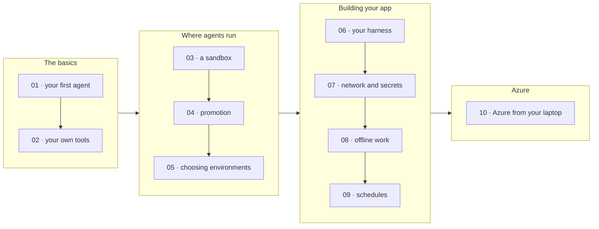

# Walkthroughs

Ten short, hands-on walkthroughs. Each one has a small, commented script you run against your platform, a diagram of
what happens, and the real output from a run. Start with 01; after that, pick what you need.



| # | Walkthrough | You'll see | Time |
| --- | --- | --- | --- |
| 01 | [Your first agent](01-first-agent/README.md) | Connect, chat, then open the same conversation in Copilot CLI | 1 min |
| 02 | [Give it your own tools](02-your-own-tools/README.md) | Tools that run in your process, and an approval prompt | 1 min |
| 03 | [A coding agent in a sandbox](03-sandbox/README.md) | A file in, a report artifact out, one sandbox per session | 1 min |
| 04 | [Start cheap, move when needed](04-promotion/README.md) | A chat that moves itself into a sandbox to run Python | 1 min |
| 05 | [Choose an environment from code](05-choose-environments/README.md) | A name, a name plus additions, an inline type, and a refusal | 1 min |
| 06 | [Bring your own harness](06-harness/README.md) | One harness in three environments, then in Copilot CLI | 1 min |
| 07 | [Network rules and secrets](07-network-and-secrets/README.md) | A placeholder in the sandbox, a real value at the edge, a blocked host | 1 min |
| 08 | [Keep working while your app is offline](08-offline/README.md) | A tool call that waits for you, answered by polling | 1 min |
| 09 | [Run on a schedule](09-schedules/README.md) | A weekday schedule, run now, with the agent's reply | 1 min |
| 10 | [Your agent in Azure, from your laptop](10-azure/README.md) | The same samples against Azure, and a sandbox in Copilot CLI | 5 min |

## Before you start

You need the platform running. From the repository root:

```powershell
pnpm install
pnpm build
aspire run          # leave it running; use another terminal for the samples
```

Then run any walkthrough by number, from the repository root or this folder:

```powershell
pnpm sample 01
```

- **Where it runs.** Samples connect like any app: to your local `aspire run`, or to the deployment in
  `MANAGED_COPILOT_URL` ([walkthrough 10](10-azure/README.md)).
- **Who you are.** Your GitHub sign-in: `gh auth login`, or `GH_TOKEN`. Model calls use your Copilot plan.
- **Why here.** `@managed-copilot/sdk` isn't published to npm yet, so the samples live in this workspace. Copy one
  into another workspace package to build on it.
- **Cleanup.** Every sample deletes the sessions, vaults, and schedules it creates, except 01, which leaves its
  session running so you can open it in Copilot CLI. `npx managed-copilot sessions` lists what you have.

Model replies differ from run to run; IDs and timings will be yours. Everything else should look like the output in
each walkthrough. To understand the ideas behind them, read the [concept pages](../docs/README.md).
