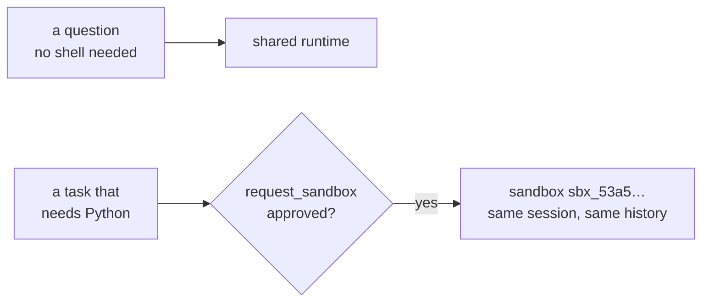

# 04 · Start cheap, move when needed

Start a session on the shared runtime, then ask for something that needs Python. The agent asks for a sandbox, you
approve, and the same session continues there with its history.

**You need:** the platform running with Docker (`aspire run`). **Concepts:**
[promotion](../../docs/concepts/promotion.md).



## Run it

```powershell
pnpm walkthrough 04
```

## What you'll see

```text
Copilot: A CSV header row contains a comma-separated list of column names (field labels) that identify the data in each corresponding column of the rows below it.
Now on: shared runtime

  [your app] approve request_sandbox? yes

  [platform] session.promoted: 54174842-a3df-410c-acff-d2a1e1256a37 moved to sandbox sbx_53a533c64de9644e51acf5b9

  [your app] approve shell? yes

Copilot: Saved to `outputs/sum.json`: `{"result": 60}`
Now on: sandbox sbx_53a533c64de9644e51acf5b9

Copilot: Your first question asked, in one sentence, what a CSV header row contains.
```

## What happened

1. `helper` is a `promotable` environment, so the session started on the shared runtime: no sandbox, nothing to set
   up.
2. The first question needed no shell, so it stayed there.
3. The second needed Python. The agent called the platform's `request_sandbox` tool, and your
   `onPermissionRequest` approved it like any other tool.
4. The platform created a sandbox from `coder`'s settings (the `helper` environment's `promoteTo`), moved the session
   in, and `managed.on("session.promoted")` fired.
5. The turn continued in the sandbox: the agent asked to run a shell command, you approved, and it wrote
   `outputs/sum.json`. The `sendAndWait` call returned once, after all of that.
6. The last answer shows the conversation came along: same session ID, same history.

## The code

```ts
managed.on("session.promoted", (event) => console.log(`${event.sessionId} moved to sandbox ${event.sandboxId}`));

const client = await managed.client("helper");
const session = await client.createSession({ model: "claude-sonnet-5", onPermissionRequest: approveAll });

await session.sendAndWait({ prompt: "In one sentence: what does a CSV header row contain?" });
// Sandbox setup happens inside this call, so give it more than the SDK's 60-second default.
await session.sendAndWait({ prompt: "Use Python to add 10, 20, and 30, and save the result to outputs/sum.json." }, 15 * 60_000);
```

Full script: [`main.ts`](main.ts).

## Try next

- Move an idle session yourself: `await managed.promote(session)`, or `npx managed-copilot promote <session>`.
- Attach Copilot CLI before the move: it reconnects to the sandbox on its own.
- Next walkthrough: [05 · Choose an environment from code](../05-choose-environments/README.md).
