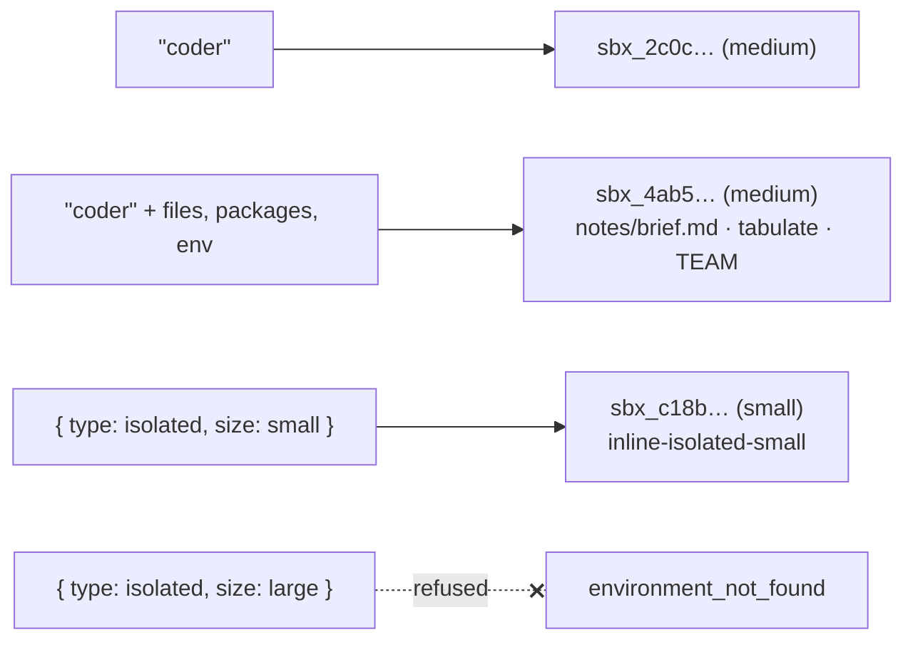

# 05 · Choose an environment from code

Pick an environment three ways: by name, by name with additions for one session, and inline by type and size. Then
see what the platform refuses.

**You need:** the platform running with Docker (`aspire run`). **Concepts:**
[environments](../../docs/concepts/environments.md).



## Run it

```powershell
pnpm walkthrough 05
```

## What you'll see

````text
1. "coder"              -> environment "coder", sandbox sbx_2c0c6063c8dd192aea64ee61 (medium)
2. "coder" + additions  -> environment "coder", sandbox sbx_4ab5d7372b67ffb716088ef7 (medium)
   This deployment allows inline: {"types":["shared","isolated"],"sizes":["small"]}
3. { isolated, small }  -> environment "inline-isolated-small", sandbox sbx_c18b9ddf9de1c28234b6ea04 (small)
4. { isolated, large }  -> refused [environment_not_found]: This deployment does not allow inline isolated environments of size large

Inside session 2's sandbox:
```
Ship the billing fix first.
TEAM=contoso-platform
tabulate 0.10.0
```
````

## What happened

1. **A name** gets exactly the template the AppHost declares: `coder` is isolated and medium.
2. **A name plus additions** gets the same template plus a file, a Python package, and an environment variable,
   installed before the agent's first turn. You can also add vaults or narrow the network this way. Additions apply
   only to this session; the next session gets plain `coder`.
3. **Inline** asks for a type and size with no name. It works only within the AppHost's `inline` setting, here
   `shared`, or `isolated` at size `small`, and uses the default sandbox image.
4. **Anything broader is refused** before a sandbox is created. A bigger size, a new image, or broader network access
   is an AppHost change, followed by `aspire run` or `aspire deploy`.

## The code

```ts
await managed.createSession({ environment: "coder", ... });                          // 1. a name

await managed.createSession({                                                        // 2. a name plus additions
  environment: {
    name: "coder",
    files: { "notes/brief.md": "Ship the billing fix first.\n" },
    packages: { python: ["tabulate"] },
    env: { TEAM: "contoso-platform" },
  },
  ...
});

await managed.createSession({ environment: { type: "isolated", size: "small" }, ... }); // 3. inline
```

`managed.client(environment, options)` takes the same choices; its options then apply to every session that client
creates. Full script: [`main.ts`](main.ts).

## Try next

- Read the AppHost's environment list: [`apphost.mts`](../../apphost.mts). `npx managed-copilot status` shows it
  too.
- Next walkthrough: [06 · Bring your own harness](../06-harness/README.md).
