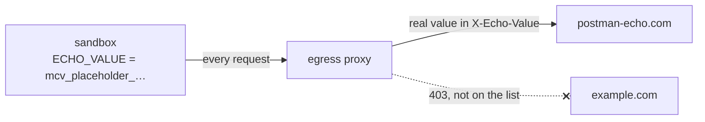

# 07 · Network rules and secrets

Limit a sandbox to one host, give it a credential through a vault, and see three things: the sandbox holds only a
placeholder, the allowed host receives the real value, and every other host is blocked.

**You need:** the platform running with Docker (`aspire run`), and Internet access to `postman-echo.com`.
**Concepts:** [network and secrets](../../docs/concepts/network-and-secrets.md).



## Run it

```powershell
pnpm walkthrough 07
```

## What you'll see

```text
  [platform] network.blocked: api.enterprise.githubcopilot.com:443 (host_not_allowed)
  [platform] network.blocked: example.com:443 (host_not_allowed)

The real value:                demo-9cd208750ff48fe4
$ECHO_VALUE in the sandbox:    mcv_placeholder_3b44d0837747de5ecee091940925ddacd8e183c5
postman-echo.com received the real value. Its echo came back as: [redacted]
example.com is not allowed:    curl: (56) CONNECT tunnel failed, response 403
  [platform] network.blocked: telemetry.enterprise.githubcopilot.com:443 (host_not_allowed)
```

## What happened

1. `managed.vaults.create` sealed a throwaway value on the platform. No API returns it again.
2. `managed.client("coder", { network: ["postman-echo.com"], vaults: [vault.id] })` narrowed `coder`, which allows any
   host, to one host for this client's sessions, and attached the vault.
3. The sample uploaded a small shell script, and the agent ran it in the sandbox. There, `$ECHO_VALUE` held only a
   placeholder. When `curl` sent it in the `X-Echo-Value` header to `postman-echo.com`, the egress proxy swapped in
   the real value on the way out.
4. postman-echo.com echoed the header back; the proxy replaced the real value in the response with `[redacted]`. That
   redaction is the proof the substitution happened.
5. `example.com` isn't on the list, so the proxy refused the connection with a 403, and the platform reported a
   `network.blocked` event to your app.
6. The other blocked hosts are the runtime's own direct calls to GitHub. They're blocked too, and nothing breaks:
   model calls go through the gateway, not the network.

## The code

```ts
const vault = await managed.vaults.create({
  name: `walkthrough-07-${randomBytes(3).toString("hex")}`,
  credentials: [{ env: "ECHO_VALUE", value: secret, hosts: ["postman-echo.com"], headers: ["x-echo-value"] }],
});

const client = await managed.client("coder", { network: ["postman-echo.com"], vaults: [vault.id] });
managed.on("network.blocked", ({ data }) => console.log(`network.blocked: ${data["host"]}:${data["port"]}`));

// What runs in the sandbox: your own script. The agent only runs it.
await managed.files(session).write("check-network.sh", [
  "mkdir -p outputs",
  'echo "$ECHO_VALUE" > outputs/sandbox-sees.txt',
  'curl -s -H "X-Echo-Value: $ECHO_VALUE" https://postman-echo.com/headers > outputs/allowed.json',
  "curl -sS -o /dev/null https://example.com 2> outputs/blocked.txt",
].join("\n"));
await session.sendAndWait({ prompt: "Run my test script with `sh check-network.sh` and reply with just its output." });
```

Full script: [`main.ts`](main.ts). It uses a throwaway value on purpose: never send a real credential to an echo
service. Agents rightly hesitate to send an environment variable to a third-party host when asked directly; running
your own script makes the intent clear.

## Try next

- Declare a vault for a whole environment in the AppHost instead, with the value in an Aspire secret parameter
  ([network and secrets](../../docs/concepts/network-and-secrets.md#secrets-vaults)).
- Use `{ network: false }` instead: `curl` fails (exit code 56 in a live run), yet the agent still answers, because
  model calls go through the gateway, not the network.
- Next walkthrough: [08 · Keep working while your app is offline](../08-offline/README.md).
