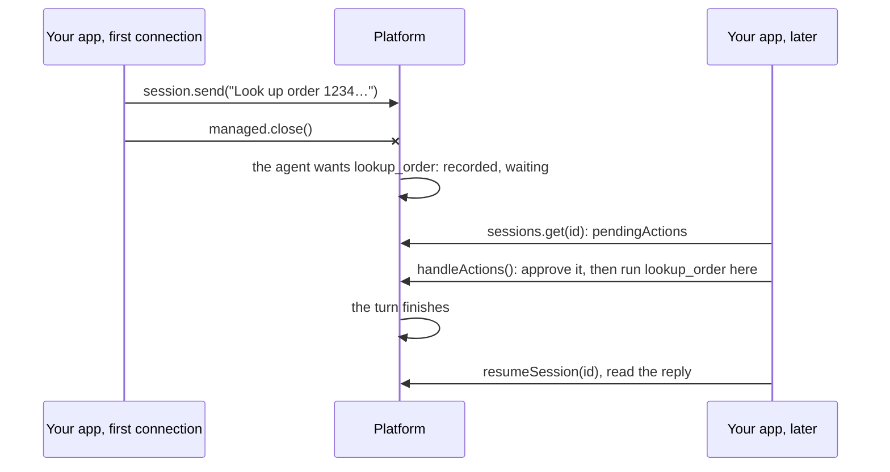

# 08 · Keep working while your app is offline

Send a prompt, disconnect before the agent needs your tool, then come back and answer the waiting tool call by
polling. Nothing is lost, and nothing runs twice.

**You need:** the platform running (`aspire run`), and background sign-in turned on once for this deployment
(`npx managed-copilot login`), so the work can keep running as you while your app is away. **Concepts:**
[work while you're away](../../docs/concepts/offline-work.md).



## Run it

```powershell
pnpm walkthrough 08
```

## What you'll see

```text
1. Sent a prompt to session 81347015-bae0-42ab-b799-17949e111a06, then disconnected.
2. Reconnected. Answering whatever waits for this app:
   waiting: permission request for lookup_order
   waiting: call to lookup_order {"id":"1234"}
   [your app] lookup_order 1234 ran in this process
3. Copilot: Order **1234** is **shipped** via UPS and is expected to arrive **Friday**.
```

## What happened

1. `session.send` (not `sendAndWait`) handed the prompt to the platform, and `managed.close()` disconnected before
   the agent got far.
2. The agent kept working. With no app connected, its permission request for `lookup_order` and then the tool call
   itself became **durable actions**, waiting on the platform.
3. A new connection, signed in as the same GitHub account, listed them with `sessions.get(id).pendingActions` and
   answered them with `sessions.handleActions`, which claims each action, runs your handler, and records the result.
4. The turn finished on the platform. `resumeSession` reattached to read the reply, exactly as an app does after a
   restart.

## The code

```ts
const handlers = { tools: [lookupOrder], onPermissionRequest: approveAll };

// 1. Start the work, then leave.
const session = await app.createSession({ environment: "chat", model: "claude-sonnet-5", ...handlers });
await session.send({ prompt: "Look up order 1234 and tell me when it arrives." });
await app.close();

// 2. Later, from any process signed in as you: answer what waits until the turn is over.
for (;;) {
  const { pendingActions, lastTurn } = await later.sessions.get(session.sessionId);
  if (pendingActions.length > 0) await later.sessions.handleActions(session.sessionId, handlers);
  else if (lastTurn?.status === "completed") break;
  await sleep(1_000);
}

// 3. Read the reply.
const resumed = await later.resumeSession(session.sessionId, handlers);
const reply = (await resumed.getEvents()).filter((event) => event.type === "assistant.message").at(-1);
```

The full script also stops on a failed turn or after four minutes, and deletes the session at the end:
[`main.ts`](main.ts).

## Try next

- Answer from a webhook instead of polling: declare one in the AppHost and call `verifyWebhook` and
  `event.handleActions` in your endpoint ([offline work](../../docs/concepts/offline-work.md#answer-with-a-webhook)).
  The quickstart's [`10-offline-webhook.ts`](../../tests/snippets/src/10-offline-webhook.ts) runs one locally.
- Leave an action unanswered and it expires after 24 hours: the agent gets an error, never an automatic yes.
- Next walkthrough: [09 · Run on a schedule](../09-schedules/README.md).
