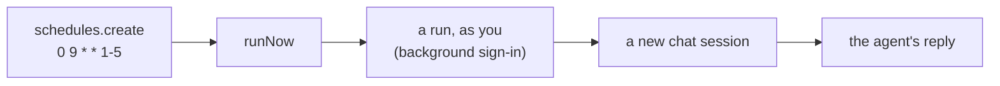

# 09 · Run on a schedule

Create a weekday schedule, run it right away, and read what the agent wrote. Scheduled runs act as you, even while
you're away.

**You need:** the platform running (`aspire run`), and background sign-in turned on once for this deployment.
**Concepts:** [work while you're away](../../docs/concepts/offline-work.md#run-on-a-schedule),
[identity](../../docs/concepts/identity.md#work-that-continues-while-youre-away).



## Run it

Once per deployment, let scheduled work run as you:

```text
> npx managed-copilot login
✓ Background sign-in is on for @your-login at http://localhost:7400
  Scheduled runs and work that continues while you're away now run as you.
  Turn it off any time with: npx managed-copilot logout
```

Then:

```powershell
pnpm walkthrough 09
```

## What you'll see

```text
Created standup-reminder-24e58d61: "0 9 * * 1-5" in America/Los_Angeles
  state active, next run 2026-10-27T16:00:00.000Z
Run run_d6n6G89T4UuTj9BSw0kItQ started...
Run completed in session 7e943d7f-c2b5-8ab5-b68a-6d1e323c0198

Copilot (scheduled run):
Review open pull requests before lunch.
Update your tickets with today's progress before end of day.
```

Without background sign-in, the sample stops with the platform's explanation instead:

```text
09-schedules stopped: Schedules run as you while you're away. Sign in once with `npx managed-copilot login` so work can continue while you're away. [authentication_required]
```

## What happened

1. `schedules.create` stored a cron schedule for 9:00 on weekdays, Seattle time. Its next run is 16:00 UTC.
2. `runNow` started a run immediately. The `invocationId` makes a retried call return the same run instead of starting
   a second one.
3. The run created a new session in `chat` as you, using your background sign-in, and sent the prompt.
4. Each run is an ordinary session you own, so `resumeSession` could read its reply.
5. The sample deleted the run's session and the schedule.

## The code

```ts
const schedule = await managed.schedules.create({
  name: `standup-reminder-${randomUUID().slice(0, 8)}`,
  cron: "0 9 * * 1-5",
  timeZone: "America/Los_Angeles",
  environment: "chat",
  prompt: "Write a two-line stand-up reminder: review open pull requests, then update your tickets.",
});

const run = await managed.schedules.runNow(schedule.id, { invocationId: randomUUID() });
// poll managed.schedules.runs(schedule.id) until the run is completed, failed, or skipped
```

Full script: [`main.ts`](main.ts).

## Try next

- `npx managed-copilot schedules` lists your schedules; `schedules runs <schedule>` shows their runs.
- Give a schedule your app's tools with `session: { tools: [...] }` and `webhook: "<name>"`: only the tool
  declarations are stored, and calls are answered by your webhook.
- Let the agent schedule its own reminders: set `scheduling: true` on an environment, as the
  [assistant demo](../../demos/assistant/README.md) does.
- Turn background sign-in off again with `npx managed-copilot logout`; schedules that need it pause.
- Next walkthrough: [10 · Your agent in Azure, from your laptop](../10-azure/README.md).
