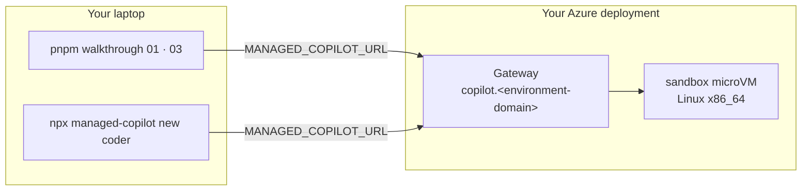
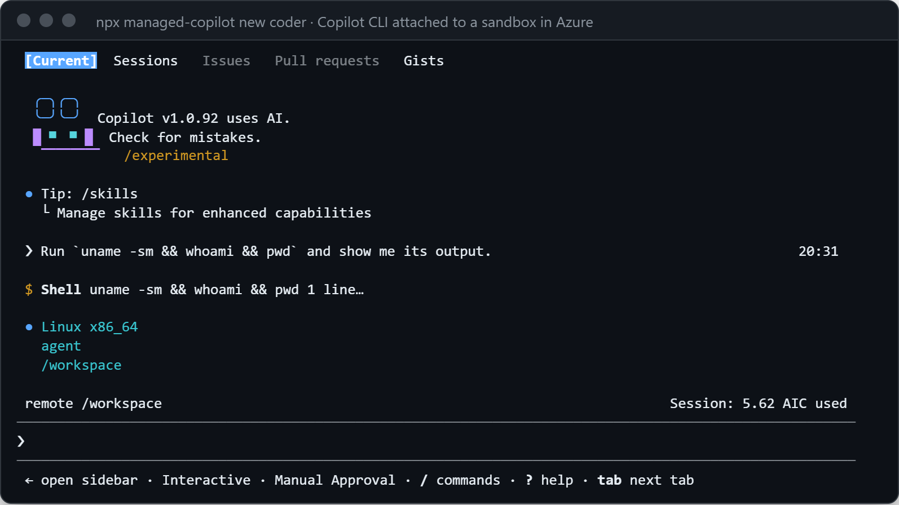

# 10 · Your agent in Azure, from your laptop

Run the same samples against your Azure deployment, and open one of its sandboxes in Copilot CLI. Nothing in the code
changes: only where it connects.

**You need:** an Azure deployment of this AppHost ([deploying to Azure](../../docs/deployment.md)), and your GitHub
account on its access list. **Concepts:** [local and Azure](../../docs/concepts/local-and-azure.md),
[identity](../../docs/concepts/identity.md).



## 1. Deploy, and let yourself in

If you don't have a deployment yet, follow [deploying to Azure](../../docs/deployment.md). A deployed gateway only
accepts the GitHub accounts and organizations you name:

```powershell
aspire secret set Parameters:copilot-github-users "your-login,teammate"   # the whole list
aspire deploy
```

## 2. Point at it

```powershell
$env:MANAGED_COPILOT_URL = "https://copilot.<environment-domain>"   # printed by aspire deploy
npx managed-copilot status
```

```text
Deployment    copilot · azure · v0.1.0 · https://copilot.<environment-domain>
Signed in     @your-login
Background    on since 2 days ago
Environments  chat (shared, network: learn.microsoft.com), coder (isolated, medium), helper (promotable, small, -> coder), …
Capabilities  actions, artifacts, attach.cli, background, events, files, isolated, network.policy, promotion, schedules, shared, vaults, web_fetch, webhooks
Runtime       Copilot SDK 1.0.31, runtime 1.0.109
```

## 3. Run the samples

```powershell
pnpm walkthrough 01
```

```text
Connected to https://copilot.<environment-domain> (azure) as @your-login

Copilot: An AI agent could automate repetitive tasks like code reviews, testing, and bug triage, freeing developers to focus on building features. It can also help with documentation, answering support questions, and surfacing insights from logs or metrics to speed up decision-making.

Session 4864fa95-a892-40e6-bdb0-c57d967257de
  environment: chat (shared)
  placement:   shared
  state:       idle

Open it in Copilot CLI:  npx managed-copilot attach 4864fa95
```

```powershell
pnpm walkthrough 03
```

````text
Creating a session. Its sandbox is ready before createSession returns...
Session 3705d75c-f3b3-4a0a-860e-0f7832a8fb2f runs in sandbox sbx_c95b78ba9df9678ce8266887 (medium)

Inside the sandbox:
```
Linux x86_64
agent
/workspace
sales.csv
```

Published outputs/report.md (version 1, 271 bytes)
…
A second session from the same client runs in sandbox sbx_4bfc8a894107f1ff61a0d500
````

The sandbox is now an Azure Container Apps Sandboxes microVM: `x86_64`, even though the laptop running the sample is
ARM64. The run took about a minute, most of it creating two sandboxes.

## 4. Open a sandbox in Copilot CLI

```powershell
npx managed-copilot new coder
```

```text
● Starting a new coder session · its own sandbox
  Setting up its sandbox…
✓ Session 6902ba6e is ready. Opening Copilot CLI…
  The session keeps running when you exit Copilot CLI.
```

Ask it to run ``uname -sm && whoami && pwd``, and approve the shell command:

<p align="center">
  
</p>

The footer reads `remote /workspace`. The CLI runs on your laptop and reaches the session only through a relay on
`127.0.0.1`; the `managed-copilot` process holds the one connection to the gateway in Azure
([why it looks local](../../docs/concepts/copilot-cli.md#why-it-looks-local)).

## What happened

1. `MANAGED_COPILOT_URL` pointed the SDK and the CLI at the deployment. The same code, unchanged, ran there.
2. The gateway checked your GitHub sign-in against the deployment's access list, then owned your sessions by your
   GitHub account ID.
3. Isolated sessions got Azure microVMs instead of Docker containers. Model calls still used your Copilot plan.

## Good to know

- `@managed-copilot/sdk` isn't on npm yet, so scripts that use it run inside this workspace, as these samples do.
- Azure can't reach a webhook on your laptop. Polling ([walkthrough 08](../08-offline/README.md)) works from
  anywhere; deployed apps can receive webhooks.
- Sessions you start with `new` keep running after you exit. An idle sandbox stops after 15 minutes and keeps only its
  disks; `managed.sessions.delete(id)` removes it for good.
- Costs and teardown: [deploying to Azure](../../docs/deployment.md#cost).
